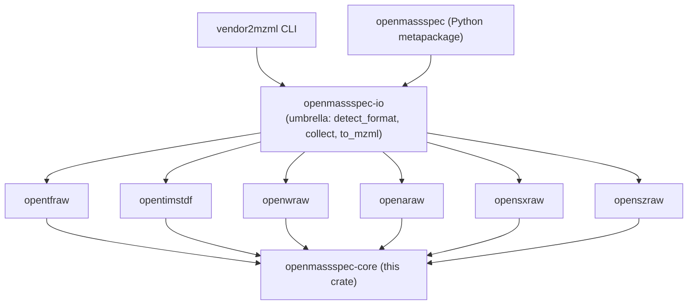

# `openmassspec-core`

`openmassspec-core` is the shared Rust foundation every vendor parser in
the stack builds on. It defines the vendor-neutral records, the
`SpectrumSource` trait, the canonical mzML 1.1.0 writer, and the
cross-vendor conformance harness. The Apache Arrow bridge is the
separate `openmassspec-arrow` crate.

- Crate: [Sigilweaver/OpenMassSpecCore](https://github.com/Sigilweaver/OpenMassSpecCore)
- License: Apache-2.0
- MSRV: 1.88
- `#![forbid(unsafe_code)]`

## Install

```toml
[dependencies]
openmassspec-core = "3"

# Optional: Arrow RecordBatch builder.
openmassspec-arrow = "3"
```

## The `SpectrumSource` trait

Every vendor parser (`opentfraw`, `opentimstdf`, `openwraw`, `openaraw`,
`opensxraw`, `openszraw`) implements this trait. Anything downstream of a parser -
the canonical mzML writer, the Arrow batch builder, the conformance
harness, the `openmassspec-io` umbrella, the `vendor2mzml` CLI -
operates against `&mut dyn SpectrumSource`.

```rust
use openmassspec_core::{ChromatogramIter, CvTerm, RunMetadata, SpectrumIter};

pub trait SpectrumSource {
    fn run_metadata(&self) -> RunMetadata;
    // Box<dyn Iterator<Item = openmassspec_core::Result<SpectrumRecord>> + 'a>
    fn iter_spectra<'a>(&'a mut self) -> SpectrumIter<'a>;
    fn iter_chromatograms<'a>(&'a mut self) -> ChromatogramIter<'a> {
        Box::new(std::iter::empty())
    }
    fn spectrum_count_hint(&self) -> Option<usize> { None }
    fn additional_processing_steps(&self) -> Vec<CvTerm> { Vec::new() }
}
```

Boxed iterators (rather than RPITIT) keep the trait dyn-compatible so
the rest of the stack can hold `&mut dyn SpectrumSource`. Items are
`Result`s: a record the parser cannot decode is an `Err`, never
skipped.

## Public API

| Symbol                                                      | Module          | Purpose                                                                  |
| ----------------------------------------------------------- | --------------- | ------------------------------------------------------------------------ |
| `SpectrumRecord`                                            | `types`         | Decoded spectrum: id, ms level, polarity, rt, peaks, precursor.          |
| `PrecursorInfo`                                             | `types`         | Selected / isolated precursor, charge, activation, scan window.          |
| `ChromatogramRecord`                                        | `types`         | TIC / BPC / SRM trace.                                                   |
| `RunMetadata`                                               | `types`         | Run-level CV terms: instrument, source format, native id format.         |
| `CvTerm`                                                    | `types`         | A PSI-MS controlled-vocabulary term.                                     |
| `Polarity`, `Analyzer`, `ScanMode`, `MsPower`, `Activation` | `enums`         | Standard enumerations.                                                   |
| `MobilityArrayKind`                                         | `enums`         | Per-peak inverse-mobility / drift-time array kind.                       |
| `SpectrumSource`                                            | `source`        | Trait every parser implements.                                           |
| `write_mzml`                                                | `mzml`          | Stream a `SpectrumSource` to a plain mzML 1.1.0 document.                |
| `write_indexed_mzml`                                        | `mzml`          | Same, with `<indexList>` + SHA-1 footer for byte-offset indexing.        |
| `write_mzml_with_options`, `WriteOptions`                   | `mzml`          | Compression and `RecordErrorPolicy` (fail or skip unreadable records).   |
| `WriteSummary`                                              | `mzml`          | Records written and skipped by a write.                                  |
| `conformance::assert_source_invariants`                     | `conformance`   | Check a live `SpectrumSource` for cross-vendor invariants.               |
| `conformance::assert_iter_invariants`                       | `conformance`   | Same, but from any `IntoIterator<Item = SpectrumRecord>`.                |
| `Error`                                                     | `error`         | Aggregate `thiserror`-based error type.                                  |

## mzML writer

```rust
use openmassspec_core::{write_indexed_mzml, SpectrumSource};

fn export<S: SpectrumSource>(mut src: S, path: &std::path::Path)
    -> openmassspec_core::Result<()>
{
    let mut out = std::fs::File::create(path)?;
    let summary = write_indexed_mzml(&mut src, &mut out)?;
    println!("{} spectra", summary.spectra_written);
    Ok(())
}
```

`write_indexed_mzml` emits a standards-compliant `<indexList>` plus a
SHA-1 footer so downstream tools (`mzML2HDF`, ProteoWizard `msconvert`,
`MzIdentML` builders, ...) can index-jump into the file.

## Conformance harness

The harness enforces the cross-vendor invariants every parser must
satisfy, surfaced as structured `ConformanceError` variants
(`PeakArrayLengthMismatch`, `MobilityArrayLengthMismatch`,
`RetentionTimeNonMonotonic`, `MissingPrecursor`, `IndexSequence`,
`EmptySpectrum`, ...).

```rust
use openmassspec_core::conformance::assert_iter_invariants;

let count = assert_iter_invariants(records)?;
println!("validated {count} spectra");
# Ok::<(), openmassspec_core::conformance::ConformanceError>(())
```

The [`vendor2mzml validate`](./quickstart-cli.md#validate) subcommand
runs this harness on any vendor input or pre-existing mzML.

## Arrow bridge (crate: `openmassspec-arrow`)

```rust
# fn _doc() -> Result<arrow_array::RecordBatch, arrow_schema::ArrowError> {
use openmassspec_arrow::SpectrumBatchBuilder;

// Pass the source's mobility_array_kind (None for instruments without
// ion mobility); it applies to every row in the batch.
let mut b = SpectrumBatchBuilder::new(None);
for s in /* SpectrumSource iter_spectra */ std::iter::empty() {
    b.push(&s);
}
let batch = b.finish()?;
# Ok(batch)
# }
```

The canonical schema is documented in
[Arrow schema](./arrow-schema.md).

## Where it sits in the stack


